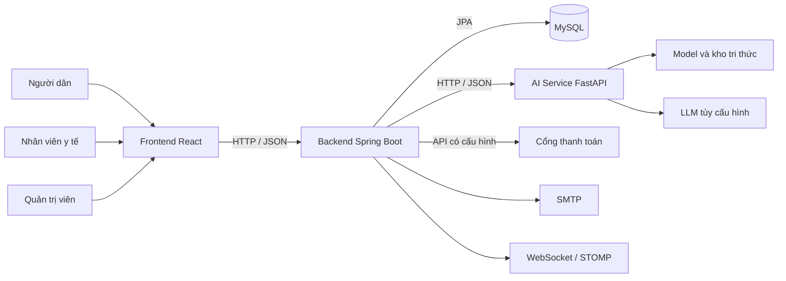
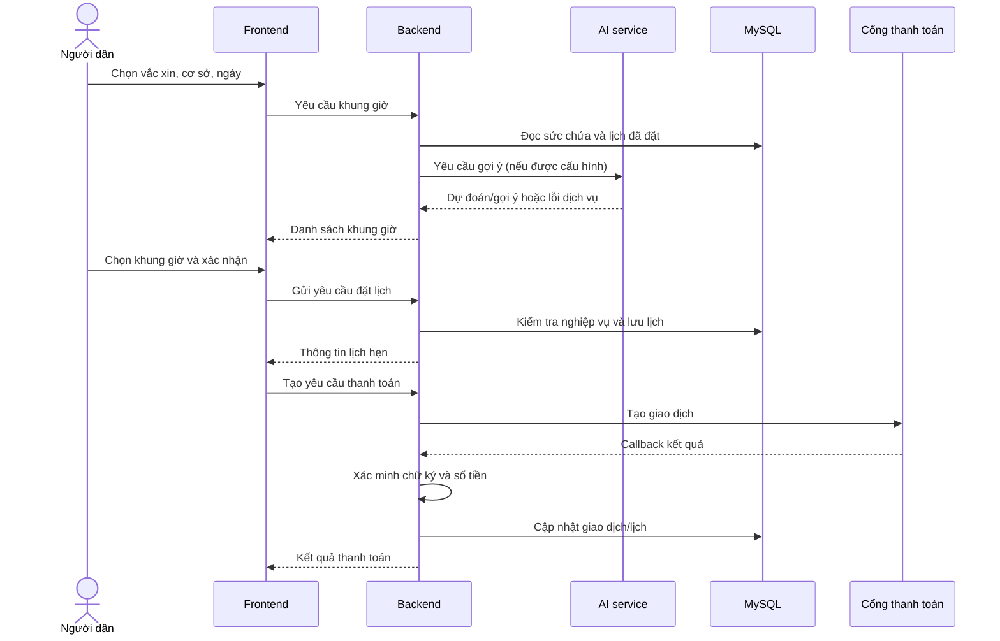
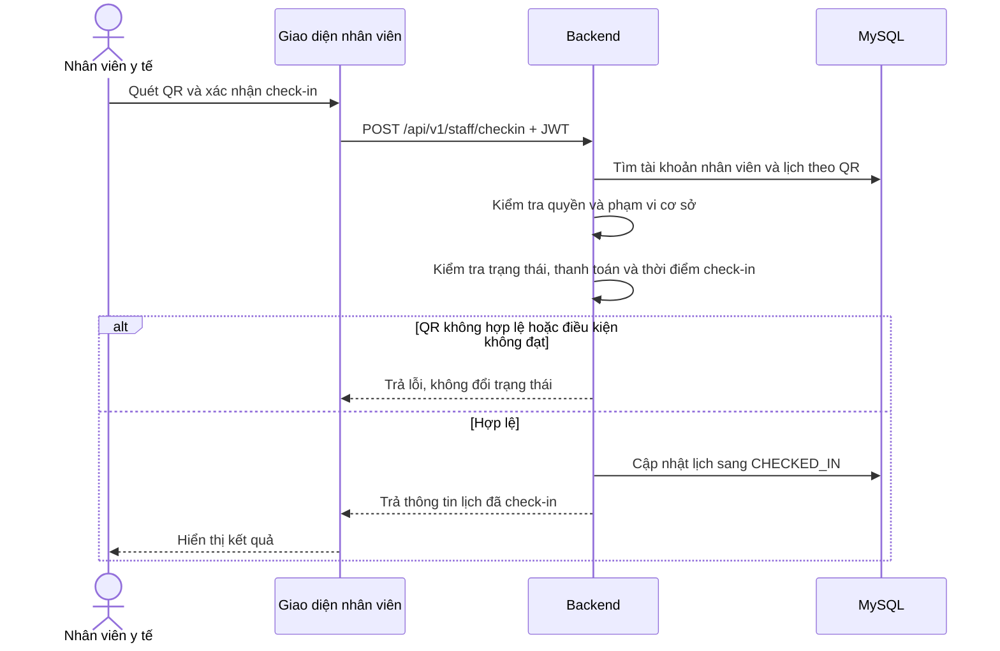
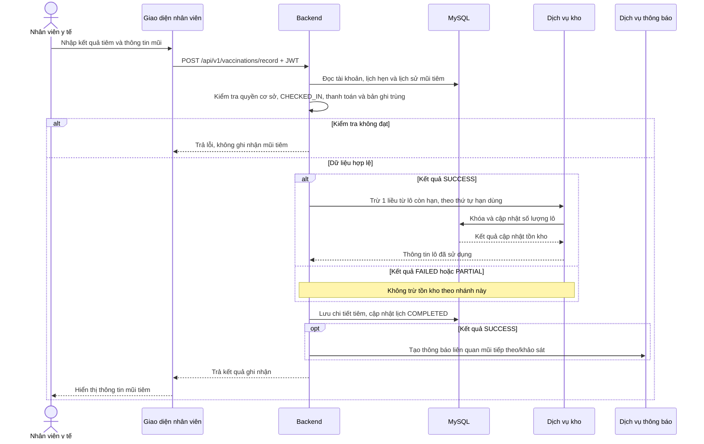
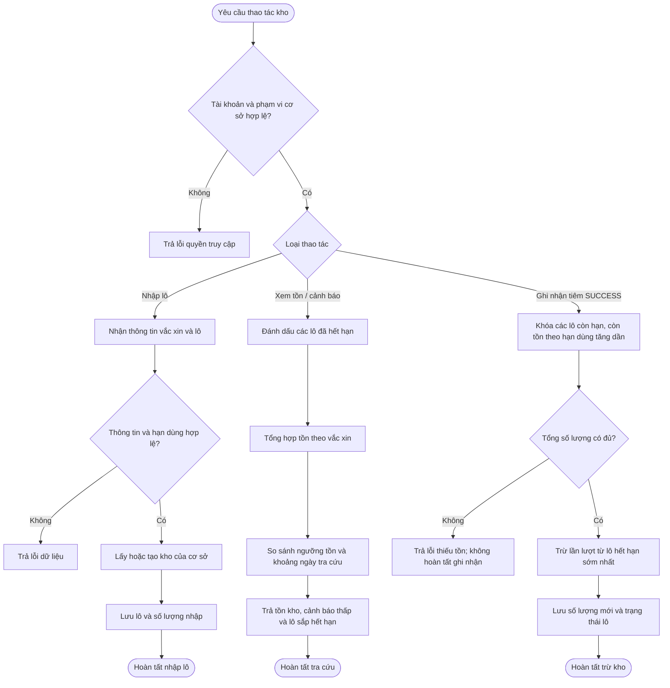
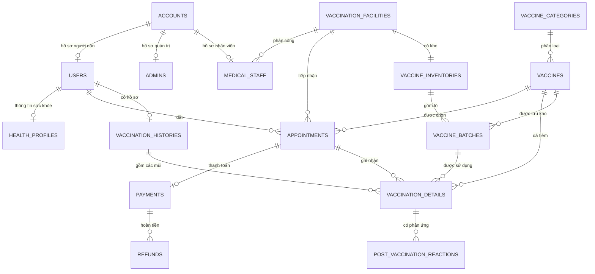

# CHƯƠNG 3. PHÂN TÍCH VÀ THIẾT KẾ HỆ THỐNG

## 3.1. Mô tả bài toán

VaxCare cần hỗ trợ ba nhóm người dùng chính: người dân, nhân viên y tế và quản trị viên. Mỗi nhóm thực hiện các nghiệp vụ khác nhau nhưng cùng sử dụng dữ liệu về tài khoản, cơ sở, vắc xin, lịch hẹn, hồ sơ tiêm và tồn kho.

Hệ thống được thiết kế để:

- Cung cấp một giao diện web cho từng vai trò.
- Tập trung nghiệp vụ và quyền truy cập ở backend.
- Lưu dữ liệu có cấu trúc trong MySQL.
- Gọi AI service để bổ sung gợi ý lịch, dự báo nhu cầu và tư vấn thông tin có giới hạn.

## 3.2. Tác nhân và yêu cầu hệ thống

### 3.2.1. Tác nhân

| Tác nhân | Mô tả |
|---|---|
| Khách chưa đăng nhập | Tra cứu thông tin công khai như cơ sở và danh mục vắc xin; có thể sử dụng chatbot theo cấu hình. |
| Người dân (`USER`) | Quản lý thông tin cá nhân, đặt và theo dõi lịch hẹn, xem hồ sơ tiêm và gửi phản ứng sau tiêm. |
| Nhân viên y tế (`MEDICAL_STAFF`) | Thao tác với lịch hẹn, check-in, ghi nhận tiêm và quản lý kho trong phạm vi cơ sở được phân công. |
| Quản trị viên (`ADMIN`) | Quản lý tài khoản, cơ sở, dữ liệu danh mục và theo dõi báo cáo/dự báo. |
| Dịch vụ ngoài | AI service, cổng thanh toán, SMTP và các thành phần realtime được gọi qua cấu hình. |

### 3.2.2. Yêu cầu chức năng

| Mã | Yêu cầu |
|---|---|
| FR-01 | Cho phép đăng ký, đăng nhập, xác thực tài khoản và quản lý thông tin hồ sơ. |
| FR-02 | Cho phép tra cứu cơ sở, vắc xin, danh mục, giá và phác đồ tiêm. |
| FR-03 | Cho phép người dân tra cứu khung giờ, đặt lịch, xem lịch hẹn, hủy hoặc đổi lịch theo quy tắc nghiệp vụ. |
| FR-04 | Hỗ trợ tạo giao dịch thanh toán, tiếp nhận callback và tra cứu trạng thái giao dịch theo cấu hình cổng thanh toán. |
| FR-05 | Hỗ trợ mã QR cho một số bước của lịch hẹn như tra cứu và check-in. |
| FR-06 | Cho phép nhân viên tìm/xác nhận lịch, check-in và ghi nhận kết quả tiêm. |
| FR-07 | Lưu lịch sử tiêm và cho phép tra cứu hồ sơ theo quyền truy cập. |
| FR-08 | Cho phép ghi nhận, xử lý và theo dõi phản ứng sau tiêm. |
| FR-09 | Hỗ trợ quản lý lô vắc xin, số lượng tồn, ngưỡng cảnh báo và lô sắp hết hạn. |
| FR-10 | Cung cấp thông báo, báo cáo và các chức năng quản trị phù hợp với vai trò. |
| FR-11 | Tích hợp AI để gợi ý khung giờ và dự báo nhu cầu vắc xin. |
| FR-12 | Cung cấp chatbot tra cứu thông tin trong phạm vi dữ liệu và quy tắc an toàn đã cấu hình. |

### 3.2.3. Yêu cầu phi chức năng

Các yêu cầu sau là định hướng thiết kế và vận hành của hệ thống:

- **Bảo mật:** xác thực các API cần đăng nhập; phân quyền theo vai trò và phạm vi cơ sở; hạn chế dữ liệu hồ sơ y tế theo quyền.
- **Toàn vẹn dữ liệu:** dùng ràng buộc quan hệ và transaction cho các thao tác nghiệp vụ có nhiều bước.
- **Khả năng bảo trì:** chia mã nguồn thành frontend, backend, AI service và database; trong backend và AI service tiếp tục chia theo chức năng.
- **Khả năng tích hợp:** các thành phần trao đổi qua API với cấu trúc request/response xác định.
- **Khả năng chịu lỗi:** các chức năng AI là phần hỗ trợ; một số luồng có thể tiếp tục với kết quả mặc định/heuristic khi AI không sẵn sàng.
- **An toàn thông tin:** cấu hình secret và URL dịch vụ theo môi trường; không đưa thông tin xác thực vào mã nguồn hoặc giao diện.
- **Giới hạn y tế:** AI/chatbot chỉ cung cấp thông tin hỗ trợ, không thay thế chuyên môn y tế.

## 3.3. Thiết kế kiến trúc

### 3.3.1. Kiến trúc mức cao

### 3.3.2. Trách nhiệm từng thành phần

| Thành phần | Trách nhiệm |
|---|---|
| Frontend | Hiển thị trang theo vai trò, thu thập dữ liệu đầu vào, gọi API và trình bày kết quả. |
| Backend | Xác thực, phân quyền, kiểm tra quy tắc nghiệp vụ, quản lý giao dịch dữ liệu và kết nối dịch vụ ngoài. |
| AI service | Nhận dữ liệu từ backend, chạy model/rule/chatbot và trả kết quả theo schema API. |
| MySQL | Lưu dữ liệu tài khoản, danh mục, lịch hẹn, thanh toán, hồ sơ, tồn kho và các bản ghi hệ thống. |
| Dịch vụ ngoài | Xử lý thanh toán, gửi email hoặc cung cấp LLM tùy cấu hình môi trường. |

Frontend không kết nối trực tiếp với MySQL. Backend là điểm kiểm soát nghiệp vụ và quyền truy cập dữ liệu.

### 3.3.3. Phân chia module

- **Frontend:** `pages/` chứa trang; `components/` chứa thành phần giao diện; `routes/` quản lý điều hướng; `services/` gọi backend.
- **Backend:** các module theo nghiệp vụ gồm xác thực, lịch hẹn, thanh toán, vắc xin, cơ sở, kho, tiêm chủng, phản ứng, báo cáo và AI.
- **AI service:** `routers/` khai báo API; `services/` xử lý model; `chatbot/` điều phối intent, rules, retrieval và LLM.
- **Database:** các bảng được nhóm theo tài khoản, danh mục, lịch hẹn, hồ sơ tiêm, thanh toán, kho và hoạt động hệ thống.

## 3.4. Thiết kế luồng nghiệp vụ chính

### 3.4.1. Đặt lịch tiêm

1. Người dân chọn vắc xin, cơ sở, ngày và khung giờ.
2. Frontend yêu cầu backend trả danh sách khung giờ còn chỗ.
3. Backend tính sức chứa dựa trên số lịch đã đặt; nếu AI khả dụng, kết quả có thể được bổ sung thông tin gợi ý. Nếu gọi AI thất bại, backend vẫn có thể trả danh sách khung giờ cơ bản.
4. Khi nhận yêu cầu đặt lịch, backend kiểm tra dữ liệu, tình trạng cơ sở/vắc xin, tồn kho, giờ hoạt động, sức chứa, lịch trùng và các giới hạn phác đồ.
5. Backend lưu lịch hẹn. Với lịch cần thanh toán, người dùng chọn phương thức thanh toán và được chuyển sang cổng tương ứng.
6. Backend xác minh callback thanh toán. Khi giao dịch hợp lệ và lịch còn hiệu lực, trạng thái thanh toán/lịch hẹn được cập nhật; mã QR được tạo hoặc giữ lại theo quy trình.
7. Người dân xem lịch hẹn và mã QR trong giao diện.

Sơ đồ mô tả luồng tổng quát cho lịch cần thanh toán. Một số trường hợp đặc biệt có thể có trạng thái ban đầu hoặc bước xử lý khác.

### 3.4.2. Check-in và ghi nhận tiêm

1. Nhân viên tìm lịch hẹn hoặc quét mã QR của người dân.
2. Backend kiểm tra quyền nhân viên và phạm vi cơ sở.
3. Backend chỉ cho check-in lịch ở trạng thái phù hợp, chưa bị hủy/đánh dấu không đến và thỏa điều kiện thanh toán hoặc miễn phí.
4. Khi nhân viên ghi nhận kết quả, backend kiểm tra lịch đã check-in và chưa có kết quả ghi nhận trùng.
5. Backend lưu chi tiết tiêm và cập nhật trạng thái lịch. Chỉ khi kết quả là `SUCCESS`, hệ thống mới trừ tồn kho theo lô khả dụng.
6. Hệ thống có thể tạo thông báo hoặc sự kiện realtime theo cấu hình.

#### Sơ đồ check-in bằng mã QR

#### Sơ đồ ghi nhận kết quả tiêm

Các trạng thái lịch hẹn được định nghĩa trong mã nguồn gồm `PENDING`, `CONFIRMED`, `CHECKED_IN`, `COMPLETED`, `CANCELLED` và `NO_SHOW`.

### 3.4.3. Quản lý kho vắc xin

1. Nhân viên hoặc quản trị viên chọn cơ sở và vắc xin cần nhập.
2. Backend kiểm tra quyền truy cập cơ sở và dữ liệu lô, gồm ngày sản xuất/hạn dùng/số lượng.
3. Hệ thống lưu lô vắc xin và số lượng ban đầu.
4. Khi ghi nhận một lượt tiêm thành công, hệ thống lấy các lô còn hạn, còn tồn theo thứ tự hạn dùng để trừ số lượng.
5. Tồn kho được tổng hợp theo cơ sở và vắc xin; hệ thống hỗ trợ cảnh báo theo ngưỡng hoặc lô sắp hết hạn.

#### Sơ đồ quản lý kho vắc xin

Nhân viên y tế chỉ thao tác với kho của cơ sở được phân công; quản trị viên có thể thao tác theo phạm vi quản trị. Việc trừ kho áp dụng cho kết quả tiêm `SUCCESS`; lô còn hạn được xử lý theo thứ tự hạn dùng tăng dần (FEFO).

### 3.4.4. Gọi dịch vụ AI

Backend gửi request đến AI service qua HTTP/JSON. AI service kiểm tra schema, xử lý model/rule tương ứng rồi trả response. Với một số luồng như gợi ý khung giờ, backend có thể tiếp tục bằng dữ liệu cơ bản khi AI không phản hồi. Kết quả AI không được xem là dữ liệu nghiệp vụ cuối cùng nếu chưa qua các kiểm tra của backend.

## 3.5. Thiết kế dữ liệu

### 3.5.1. Các nhóm dữ liệu

| Nhóm | Bảng tiêu biểu | Mục đích |
|---|---|---|
| Tài khoản và hồ sơ | `accounts`, `users`, `admins`, `medical_staff`, `health_profiles` | Lưu tài khoản, vai trò và thông tin hồ sơ tương ứng. |
| Cơ sở và danh mục | `vaccination_facilities`, `vaccine_categories`, `vaccines`, `price_lists`, `vaccination_protocols`, `protocol_details` | Quản lý cơ sở, vắc xin, bảng giá và phác đồ. |
| Lịch hẹn và thanh toán | `appointments`, `payments`, `refunds`, `waitlists` | Theo dõi đăng ký, giao dịch và yêu cầu hoàn tiền. |
| Hồ sơ tiêm | `vaccination_histories`, `vaccination_details`, `post_vaccination_reactions` | Lưu lịch sử các mũi tiêm và phản ứng sau tiêm. |
| Kho | `vaccine_inventories`, `vaccine_batches` | Quản lý tồn kho theo cơ sở và từng lô. |
| Hệ thống | `notifications`, `chat_messages`, `chatbot_sessions`, `chatbot_messages`, `audit_logs` | Lưu thông báo, hội thoại và nhật ký hoạt động. |
| Dữ liệu AI | `schedule_overload_predictions`, `demand_forecasts` | Lưu một số kết quả dự báo liên quan đến lịch và nhu cầu. |

### 3.5.2. Quan hệ dữ liệu chính

Sơ đồ dưới đây thể hiện các quan hệ chính; không thay thế đầy đủ schema SQL.

Các quan hệ và ràng buộc chi tiết được khai báo trong [`database/vaxcare_2026.sql`](../database/vaxcare_2026.sql). Một số quy tắc nghiệp vụ, như ngăn ghi nhận tiêm trùng hoặc kiểm tra quyền theo cơ sở, được xử lý ở backend thay vì chỉ dựa vào khóa ngoại.

## 3.6. Thiết kế API và bảo mật

### 3.6.1. Quy ước API

- API backend sử dụng tiền tố `/api/v1`.
- Request/response chủ yếu dùng JSON và có cấu trúc schema/DTO.
- Các endpoint được nhóm theo nghiệp vụ, ví dụ `/appointments`, `/payments`, `/inventory`, `/vaccinations` và `/auth`.
- AI service có các nhóm endpoint như `/api/v1/ai/...` và `/api/v1/chatbot/chat`.
- Swagger/OpenAPI hỗ trợ tra cứu API backend và AI service trong môi trường phát triển.

### 3.6.2. Thiết kế kiểm soát truy cập

- Người dùng được xác thực bằng JWT trên các API cần đăng nhập.
- Quyền thao tác được phân theo `USER`, `MEDICAL_STAFF` và `ADMIN`.
- Nhân viên y tế bị giới hạn thao tác theo cơ sở được gán.
- Callback thanh toán được mở để cổng thanh toán gọi; backend phải xác minh chữ ký, mã giao dịch và số tiền trước khi cập nhật trạng thái.
- Dữ liệu hồ sơ và lịch hẹn cần được kiểm tra quyền sở hữu hoặc quyền nghiệp vụ trước khi trả về/cập nhật.
